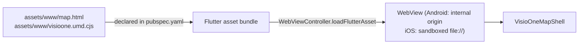
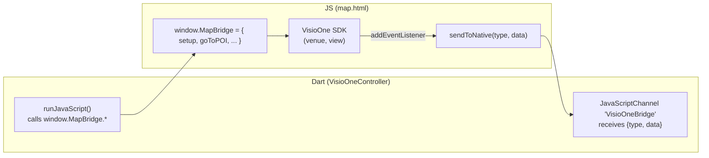
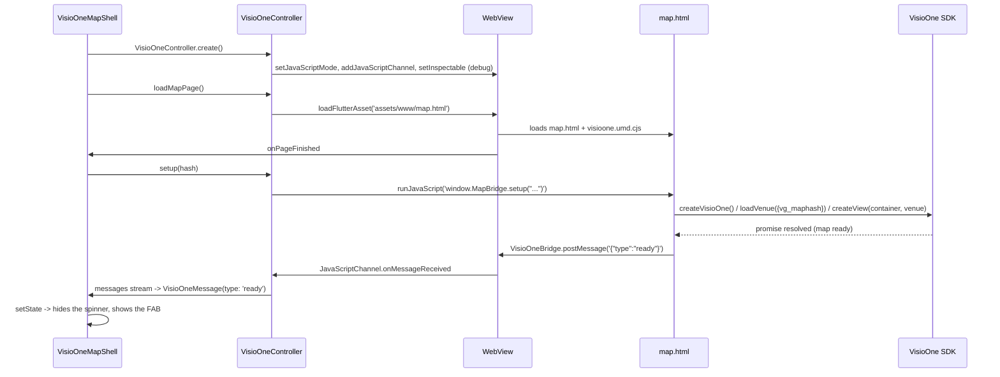

# Architecture — VisioOne in a Flutter app

## 1. The constraint

[`@visioglobe/visioone`](https://www.npmjs.com/package/@visioglobe/visioone) is a **JavaScript/WebGL** SDK (Three.js rendering in a `<canvas>`). There is no native Dart port: a Flutter app embeds a `WebView` that runs the SDK, and talks to it through a bridge.

| Piece | Choice in this repo |
|---|---|
| WebView | [`webview_flutter`](https://pub.dev/packages/webview_flutter) |
| SDK build | **UMD** (`visioone.umd.cjs`), vendored in `assets/www/` |
| Page loading | `WebViewController.loadFlutterAsset('assets/www/map.html')` |

## 2. Why the UMD bundle, not the ESM build

- The ESM build (`dist/visioone.js`) is small but loads additional chunks through dynamic `import()`. Under WebKit, ES module imports from `file://` fail because of the CORS rules applied to modules — and on iOS, `loadFlutterAsset` serves the page from `file://`.
- The **UMD** build (`dist/visioone.umd.cjs`, ~8 MB) is a self-contained bundle loaded with a classic `<script>` tag (not `type="module"`). It does no dynamic `import()`, so it works whatever origin serves the page (`file://` on iOS, the internal asset origin on Android).

The same JS runs unchanged on Android and iOS, so the UMD bundle is the one choice that works on both without a local HTTP server.

> If a future SDK release stops shipping a UMD build, the fallback is to serve the page from a real local HTTP server (for example `shelf` embedded in the app) instead of `file://`.

## 3. Loading the host page

`map.html` and `visioone.umd.cjs` must stay in the **same folder** (`assets/www/`): the page loads the bundle by relative path (`<script src="visioone.umd.cjs">`). Flutter does not include asset sub-folders recursively: a new sub-folder must be added to `pubspec.yaml`.

## 4. The bridge

- **Native → JS**: `window.MapBridge`, one method per command. Dart never touches `venue`/`view` directly. Every argument is JSON-encoded (`jsonEncode`) before being interpolated into the script, never concatenated as raw text.
- **JS → Native**: a single `JavaScriptChannel` (`VisioOneBridge`) with a `{type, data}` envelope. Adding an event means adding a message type, not a new channel.

The full contract (every command and message) is in [`COMMUNICATION_GUIDE.md`](COMMUNICATION_GUIDE.md).

## 5. App structure

- `FeatureMenuScreen` lists the features (`Feature` enum in `lib/features/feature.dart`).
- `FeatureScreen` opens one feature: a fresh `VisioOneMapShell` (new WebView, new map) per screen. Nothing is shared between two screens.
- `VisioOneMapShell` owns the `VisioOneController`, shows the loading spinner and the error screen, and opens the feature's panel (a modal bottom sheet) from the floating action button.
- The panel is rebuilt each time it is opened. Anything that must survive closing it lives on the controller, which lives as long as the screen:
  - long-running loops: `SimulatedPositionSession`, `OccupancySimulationSession`, `CameraCarouselSession`;
  - SDK state mirrored for the panel (placed label/badge/icon, current theme, highlighted category...): `ValueNotifier`s on `VisioOneController`;
  - values typed in the panel (fields, switches, last result): `PanelState` (`controller.panel`).
- Leaving the screen disposes the controller, which stops every loop.

## 6. Map display lifecycle

## 7. Out of scope

This repo is an integration starting point, not a product. Not covered:

- real indoor positioning (BLE, Wi-Fi, UWB): positions are simulated;
- real occupancy or IoT feeds: occupancy is simulated;
- a backend issuing authorization tokens: `auth-token` is a code sample with placeholder values;
- switching between several maps on the same screen.
