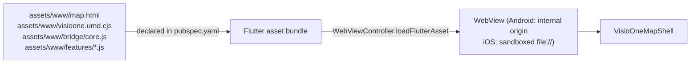
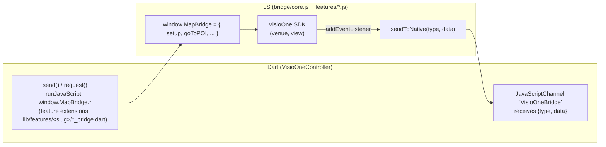
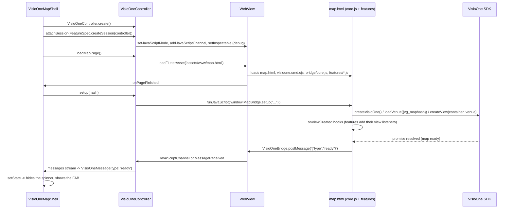

# Architecture — VisioOne in a Flutter app

## 1. The constraint

[`@visioglobe/visioone`](https://www.npmjs.com/package/@visioglobe/visioone) is a **JavaScript/WebGL** SDK (Three.js rendering in a `<canvas>`). There is no native Dart port: a Flutter app embeds a `WebView` that runs the SDK, and talks to it through a bridge.

| Piece | Choice in this repo |
|---|---|
| WebView | [`webview_flutter`](https://pub.dev/packages/webview_flutter) |
| SDK build | **UMD** (`visioone.umd.cjs`), vendored in `assets/www/` |
| Page loading | `WebViewController.loadFlutterAsset('assets/www/map.html')` |

## 2. Why the UMD bundle, not the ESM build

- The ESM build (`dist/visioone.js`) is small but loads additional chunks through dynamic `import()`. Under WebKit, ES module imports from `file://` fail because of the CORS rules applied to modules — and on iOS, `loadFlutterAsset` serves the page from `file://`.
- The **UMD** build (`dist/visioone.umd.cjs`, ~8 MB) is a self-contained bundle loaded with a classic `<script>` tag (not `type="module"`). It does no dynamic `import()`, so it works whatever origin serves the page (`file://` on iOS, the internal asset origin on Android).

The same JS runs unchanged on Android and iOS, so the UMD bundle is the one choice that works on both without a local HTTP server.

> If a future SDK release stops shipping a UMD build, the fallback is to serve the page from a real local HTTP server (for example `shelf` embedded in the app) instead of `file://`.

## 3. Loading the host page

`map.html` loads everything by relative path, as classic `<script src>` tags run in document order:

1. `visioone.umd.cjs` — the SDK;
2. `bridge/core.js` — `window.MapBridge.setup` (load/reload of the venue and view), the `{type, data}` channel to Dart, the shared helpers (`findPoi`, `poiDisplayPosition`, `resolveAnchor`, `offsetPosition`, `errorMessage`) and the `window.MapCore` registration API;
3. `features/<slug>.js` — one file per feature, in any order.

No `type="module"`: like the ESM SDK build, ES module imports fail under `file://` in WKWebView. All scripts have run before `onPageFinished` fires on the Dart side, so before the first `setup` call. Flutter does not include asset sub-folders recursively: `assets/www/bridge/` and `assets/www/features/` are listed in `pubspec.yaml`, and a new sub-folder must be added there too.

### One JS file per feature

A feature file is an IIFE that receives `window.MapCore` and:

- adds its commands to `window.MapBridge` with `MapCore.register({ goToPOI: function (poiId) { ... } })` (a name registered twice is logged as an error);
- reads the current SDK objects through `MapCore.venue` / `MapCore.view` (`null` while the map is not ready or reloading);
- installs its view listeners with `MapCore.onViewCreated(function (view) { ... })`, called for every new view just before the `ready` message;
- clears the SDK objects it created with `MapCore.onReset(function () { ... })`, called at the start of every `setup` (first load, `camera-projection-toggle` reload): without it, a reload would keep stale `Label`/`Marker`/`Image` references from the old venue;
- declares the objects it attaches to an existing POI with `MapCore.registerCreatedObjects(fn)`, so `resolveAnchor` never uses them as that POI's position.

Page-level listeners (the carousel's pointer listeners on `#container`, `window.onerror`) are registered once, at script load.

## 4. The bridge

- **Native → JS**: `window.MapBridge`, one method per command. Dart never touches `venue`/`view` directly. Every argument is JSON-encoded (`jsonEncode`) before being interpolated into the script, never concatenated as raw text. `VisioOneController` only has the generic `send(method, args)` and `request(method, args)`; each feature's typed commands are an `extension` on it in `lib/features/<slug>/<feature>_bridge.dart`, named like the `MapBridge` method they call.
- **Request/response**: `request()` adds a fresh `requestId` as first argument and completes with the `data` of the message that echoes it (whatever its `type`), or `null` after 5 s. After the screen is left, the future never completes, so code awaiting it never runs on a disposed screen.
- **JS → Native**: a single `JavaScriptChannel` (`VisioOneBridge`) with a `{type, data}` envelope. Adding an event means adding a message type, not a new channel.

The full contract (every command and message) is in [`COMMUNICATION_GUIDE.md`](COMMUNICATION_GUIDE.md).

## 5. App structure

- `lib/features/feature.dart` holds `kFeatures`, one `FeatureSpec` per feature: slug, localized title and description, panel builder, optional map overlay, map hash, `createView` options, session factory, message handler, or a custom screen (`custom-base-url`, `auth-token`). The menu and the feature screen read nothing else.
- `FeatureMenuScreen` lists `kFeatures`.
- `FeatureScreen` opens one feature: a fresh `VisioOneMapShell` (new WebView, new map) per screen. Nothing is shared between two screens.
- `VisioOneMapShell` creates the `VisioOneController`, attaches the feature's session, loads the page, shows the loading spinner and the error screen, and opens the feature's panel (a modal bottom sheet) from the floating action button.
- The panel is rebuilt each time it is opened. Anything that must survive closing it lives as long as the screen:
  - values typed in the panel and SDK state mirrored for it (fields, switches, last result, placed label/icon, current theme, highlighted category...): `PanelState` (`controller.panel`), keyed by `<slug>.<name>`;
  - long-running loops and SDK state reported while the panel is closed: the screen's `FeatureSession` (`SimulatedPositionSession`, `OccupancySimulationSession`, `CameraCarouselSession`, `CameraProjectionSession`, `HtmlOverlayMarkerSession`), created by `FeatureSpec.createSession` before the map loads and listening to `controller.messages` itself.
- Leaving the screen disposes the controller, which disposes the session (stopping its loop) and the panel state.

## 6. Map display lifecycle

## 7. Out of scope

This repo is an integration starting point, not a product. Not covered:

- real indoor positioning (BLE, Wi-Fi, UWB): positions are simulated;
- real occupancy or IoT feeds: occupancy is simulated;
- a backend issuing authorization tokens: `auth-token` is a code sample with placeholder values;
- switching between several maps on the same screen.
