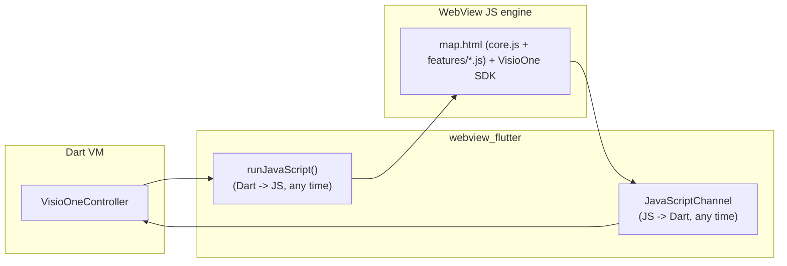

# Dart ↔ VisioOne SDK bridge

This guide covers the **communication bridge** between the Dart code and the VisioOne JavaScript SDK running inside the `WebView`. It complements [`ARCHITECTURE.md`](ARCHITECTURE.md) (overall picture) and the [README](../README.md) (setup).

**Audience:** a Flutter developer who needs to add, change or debug a call between the Dart UI and the VisioOne SDK.

---

## Contents

- [1. Two runtimes that share nothing](#1-two-runtimes-that-share-nothing)
- [2. The two channels](#2-the-two-channels)
- [3. Message contract](#3-message-contract)
- [4. Reading the existing code](#4-reading-the-existing-code)
- [5. Adding a Native → JS command](#5-adding-a-native--js-command)
- [6. Adding a JS → Native event](#6-adding-a-js--native-event)
- [7. Threading](#7-threading)
- [8. Security](#8-security)
- [9. Debugging the bridge](#9-debugging-the-bridge)

---

## 1. Two runtimes that share nothing

The app runs two isolated environments side by side: the Dart VM (`lib/`) and the WebView's JavaScript engine (`assets/www/map.html`, its scripts `bridge/core.js` and `features/*.js`, and the SDK). They share no memory: every exchange goes through the `webview_flutter` API.



`runJavaScript()` can be called at any time, not only at load: that is why `VisioOneController.setup(hash)` is an explicit JS call made after `onPageFinished`, rather than a parameter encoded in the page URL. It also lets the page call `setup()` again (to reload the map) without reloading the page itself.

## 2. The two channels

| Direction | Flutter mechanism | Used for |
|---|---|---|
| Dart → JS | `WebViewController.runJavaScript(script)` | calling `window.MapBridge.<method>(...)` |
| JS → Dart | `WebViewController.addJavaScriptChannel('VisioOneBridge', onMessageReceived: ...)` | receiving SDK events and command results as `{type, data}` messages |

Commands are fire-and-forget (`VisioOneController.send`). When a command has a result, it comes back as a JS → Dart message; when several requests of the same kind can be in flight, the command takes a `requestId` as first argument that the response echoes back — `VisioOneController.request` generates it, waits for the matching message and returns its `data` (or `null` after 5 s).

## 3. Message contract

### Native → JS (`window.MapBridge`)

Arguments are JSON-encoded on the Dart side (see [section 4](#4-reading-the-existing-code)). `setup` is defined in `assets/www/bridge/core.js`; every other method lives in its feature's script, `assets/www/features/<slug>.js`, and its typed Dart caller (same name, minus the `requestId`, which `request()` adds) in `lib/features/<slug>/<feature>_bridge.dart`:

| Feature (slug) | Methods |
|---|---|
| core (`bridge/core.js`, `VisioOneController`) | `setup` |
| `reset-view` | `goToGlobal` |
| `goto-poi` | `goToPOI`, `clearSelection` |
| `floor-selector` | `goToFloor`, `getVenueLayout` (+ `floorChanged` listener) |
| `explore-mode` | `setExploreMode`, `getExploreMode` (+ `exploreModeChanged` listener) |
| `poi-click` | — (`poiSelected` listener only) |
| `compute-navigation` | `startItinerary` (also used by `accessible-mode` and `custom-navigation-trace`) |
| `navigation-exclude-modalities` | `startItineraryExcludingModalities` |
| `custom-navigation-trace` | `updateNavigationTrace` |
| `ui-part-visibility` | `setUIPartVisible` (also used by `native-ui-replacement`) |
| `occupancy-simulated` | `updateOccupancy` |
| `clickable-surface` | `setSurfaceInteractive` |
| `simulated-position` | `resolvePoiPosition`, `injectTrackedPosition`, `stopTrackedPosition` |
| `camera-lock-on-position` | `setCameraLockOnPosition` (+ `cameraLockChanged` listeners) |
| `geofencing` | `resolvePoiZone`, `setZoneAlert` |
| `accuracy-circle-style` | `updatePositionTrackerGraphicOptions` |
| `custom-data` | `loadCustomData` |
| `category-highlight` | `getCategories`, `highlightCategory`, `clearCategoryHighlight` |
| `dynamic-poi-crud` | `createDynamicPOI`, `updateDynamicPoiLabelText`, `removeDynamicPOI` |
| `3d-icon-marker` | `placeIconImage`, `updateIconImageOrientation`, `removeIconImage` |
| `custom-text-label` | `placeTextLabel`, `updateTextLabel`, `rotateTextLabel`, `removeTextLabel` |
| `html-overlay-marker` | `placeHtmlBadge`, `updateHtmlBadgeText`, `setHtmlBadgeVisible`, `removeHtmlBadge` (+ `htmlBadgeTapped`) |
| `runtime-locale` | `getLocales`, `setCurrentLocale` (also used by `add-locale`) |
| `add-locale` | `addSpanishLocale` |
| `custom-theme` | `getThemes`, `setTheme`, `setAccentColors` |
| `camera-projection-toggle` | `setCameraProjection` |
| `camera-showcase-carousel` | `startCarousel`, `stopCarousel` |
| `auth-token` | `setAuthorizationToken` |

`custom-base-url` and `native-ui-replacement` have no script of their own; `accessible-mode` only passes `isAccessible: true` to `startItinerary`.

| Method | Arguments | What it does (SDK call) | Response |
|---|---|---|---|
| `setup(hash, baseURL, viewOptions, authorizationToken)` | `String`, `String?`, `Map?`, `String?` | (Re)loads the map: `loadVenue({vg_maphash, baseURL?, authorizationToken?})` then `createView(container, venue, viewOptions?)`. A reload destroys the previous view and venue first. | `loading`, then `ready` or `error` |
| `setCameraProjection(projection)` | `'perspective'` \| `'orthographic'` | Replays `setup` with `cameraProjection` added to the view options (the projection can only be set at view creation). | `loading`, then `ready` or `error` |
| `setAuthorizationToken(freshToken)` | `String` | `venue.setAuthorizationToken(freshToken)` for the following requests, without reloading. | — |
| `goToGlobal()` | — | `view.goToGlobal()` | — |
| `goToPOI(poiId)` | `String` | `view.goToFloor(poi.floor)` then `view.goToPOI(poi)` | — |
| `goToFloor(buildingId, floorId)` | `String`, `String?` | `view.goToFloor(floor)`, or `view.goToBuilding(building)` without `floorId` | — |
| `getVenueLayout()` | — | Reads `venue.venueLayout.buildings` and the current building/floor. | `venueLayout` |
| `setExploreMode(mode)` | `'global'` \| `'building'` \| `'floor'` | `view.currentExploreMode = mode` | `exploreModeChanged` (SDK event) |
| `getExploreMode()` | — | Reads `view.currentExploreMode`. | `exploreMode` |
| `clearSelection()` | — | Resets `selectionColor` on every surface (`venue.updateSurface`). | — |
| `startItinerary(args)` | `{origin, destination, isAccessible}` | `venue.computeNavigation(...)`, `venue.createNavigationTrace(...)`, `view.setCurrentNavigationTrace(trace)` (which replaces any previous trace on its own: no separate removal). | `itineraryComputed` |
| `startItineraryExcludingModalities(args)` | `{origin, destination, isAccessible, excludedAttributes}` | Same as `startItinerary`, with `excludedAttributes`. | `itineraryComputed` |
| `updateNavigationTrace(options)` | `{progressColor, progressOutlineColor, progressFutureColor, previewColor, previewOutlineColor}` | `venue.updateNavigationTrace(currentTrace, options)` | — |
| `setUIPartVisible(part, visible)` | `String`, `bool` | `view.setUIPartVisible(part, visible)` | — |
| `updateOccupancy(occupancy)` | `[{planId, color}]` | `venue.updateSurface(surface, {color})` on each surface of each POI; `color: null` restores the default. | — |
| `setSurfaceInteractive(placeId, interactive)` | `String`, `bool` | `venue.updateSurface(surface, {isInteractive, color, hoverColor, selectionColor})` | — |
| `resolvePoiPosition(requestId, poiId)` | `String`, `String` | Display position of a POI (see "POI display position" below). | `poiPositionResolved` |
| `resolvePoiZone(requestId, poiId)` | `String`, `String` | Reads `poi.surfaces[0].positions`. | `poiZoneResolved` |
| `setZoneAlert(placeId, active)` | `String`, `bool` | Colors the zone surfaces (`venue.updateSurface`), or restores them with `'initial'`. | — |
| `injectTrackedPosition(latitude, longitude, precisionCircleRadius)` | `double`, `double`, `double` | Sets `view.allowTracking = true` once, then `view.injectTrackedPosition({position, precisionCircleRadius})`. | — |
| `stopTrackedPosition()` | — | `view.allowTracking = false` (removes the marker and circle). | `cameraLockChanged` |
| `setCameraLockOnPosition(locked)` | `bool` | `view.lockCameraPositionOnTracking = locked` | `cameraLockChanged` |
| `updatePositionTrackerGraphicOptions(color, opacity)` | `String`, `double` | `view.updatePositionTrackerGraphicOptions({color, opacity})` | — |
| `loadCustomData(requestId, poiId)` | `String`, `String` | `venue.refreshCustomData()` then `venue.getPOICustomData(poi)` | `customDataLoaded` |
| `getCategories(requestId)` | `String` | Reads `venue.categories`, labels via `venue.translator.translateCategory`. | `categoriesLoaded` |
| `highlightCategory(categoryId)` | `String` | Colors the surfaces of every POI of the category. | — |
| `clearCategoryHighlight(categoryId)` | `String` | Restores those surfaces (`'initial'`). | — |
| `createDynamicPOI(requestId, newId, anchorId, labelText)` | `String` ×4 | `venue.createPOI({id})` then `venue.createLabel({poi, position, text})` at the anchor POI's position. | `dynamicPoiCreated` |
| `updateDynamicPoiLabelText(requestId, text)` | `String`, `String` | `venue.updateLabel(label, {text})` | `dynamicPoiLabelUpdated` |
| `removeDynamicPOI(requestId)` | `String` | `venue.removePOI(poi)` (also removes its label). | `dynamicPoiRemoved` |
| `placeIconImage(requestId, imageId, anchorId, url, orientationType)` | `String` ×5 | `venue.createImage({poi, position, width, height, url, orientationType})`, replacing the image already placed under `imageId`. | `iconImagePlaced` |
| `updateIconImageOrientation(requestId, imageId, orientationType)` | `String` ×3 | `venue.updateImage(image, {orientationType})` | `iconImageUpdated` |
| `removeIconImage(requestId, imageId)` | `String`, `String` | `venue.removeImage(image)` | `iconImageRemoved` |
| `placeTextLabel(requestId, anchorId, text, color, width, height, rotation)` | `String` ×4, `double`, `double`, `int` | `venue.createLabel({...})` next to the anchor POI, replacing the label already placed. | `textLabelPlaced` |
| `updateTextLabel(requestId, changes)` | `String`, `{text}` \| `{color}` \| `{width, height}` | `venue.updateLabel(label, changes)` | `textLabelUpdated` |
| `rotateTextLabel(requestId, rotation)` | `String`, `int` | `venue.removeLabel` + `venue.createLabel` with the new `rotation` (not in `LabelUpdateOptions`). | `textLabelUpdated` |
| `removeTextLabel(requestId)` | `String` | `venue.removeLabel(label)` | `textLabelRemoved` |
| `placeHtmlBadge(requestId, anchorId, text)` | `String` ×3 | `venue.createMarker({poi, position, element})` with a DOM element built in the page. | `htmlBadgePlaced`, then `htmlBadgeTapped` on each tap |
| `updateHtmlBadgeText(requestId, text)` | `String`, `String` | Edits `marker.element` (no SDK call). | `htmlBadgeUpdated` |
| `setHtmlBadgeVisible(requestId, visible)` | `String`, `bool` | `venue.updateMarker(marker, {isVisible})` | `htmlBadgeUpdated` |
| `removeHtmlBadge(requestId)` | `String` | `venue.removeMarker(marker)` | `htmlBadgeRemoved` |
| `getLocales(requestId)` | `String` | Reads `venue.currentLocale` and `venue.translator.allLocales`. | `localesLoaded` |
| `setCurrentLocale(locale)` | `String` | `venue.setCurrentLocale(locale)` | — |
| `addSpanishLocale(requestId, resources)` | `String`, `Map<String, String>` | `venue.translator.addLocale('es', resources)` then `venue.translator.translate(key, 'es')` for each key. | `spanishLocaleAdded` |
| `getThemes(requestId)` | `String` | Reads `view.themes`. | `themesLoaded` |
| `setTheme(name)` | `String` | `view.setTheme(name)` | `themeApplied` |
| `setAccentColors(accentColor, textAccentColor)` | `String`, `String` | `view.accentColor = ...; view.textAccentColor = ...` | `accentColorsApplied` |
| `startCarousel(poiIds)` | `List<String>` | Camera tour: `view.goToFloor` then `view.goToPOI` for each stop, in a loop; pauses on touch, resumes after 10 s. | `carouselState` |
| `stopCarousel()` | — | Stops the tour (the current animation finishes). | `carouselState` |

**POI display position.** A `POI` has no latitude/longitude of its own. Every command that needs a point for a POI (`resolvePoiPosition`, and the anchor of `createDynamicPOI`, `placeIconImage`, `placeTextLabel`, `placeHtmlBadge`) uses one helper, `MapCore.poiDisplayPosition` in `assets/www/bridge/core.js` (through `MapCore.resolveAnchor` for anchors), with this priority:

1. `poi.labels[0].position`
2. `poi.images[0].position`, else `poi.markers[0].position`
3. the centre (average of the vertices) of `poi.surfaces[0].positions`

Objects created by the demos themselves (declared with `MapCore.registerCreatedObjects`) are never used as a source.

### JS → Native (`VisioOneBridge.postMessage`, envelope `{type, data}`)

| `type` | `data` | Sent when |
|---|---|---|
| `loading` | `{hash}` | `setup()` starts loading the map. |
| `ready` | `{cameraProjection}` | `createView()` resolved: the map is shown. `cameraProjection` is `view.cameraProjection`. |
| `error` | `{message, unauthorized}` | Loading failed, or an uncaught JS error. `unauthorized: true` when the SDK rejected with `UnauthorizedError` (invalid, expired or missing token). |
| `poiSelected` | `{id, name}` | The user tapped a POI (`view` event `poiclick`). |
| `floorChanged` | `{buildingId, floorId}` | The current floor changed (`view` event `currentfloorchanged`). |
| `exploreModeChanged` | `{currentExploreMode}` | The explore mode changed, whatever the cause (`view` event `exploremodechanged`). |
| `cameraLockChanged` | `{locked}` | `view.lockCameraPositionOnTracking`, read again on each `trackingon` / `trackingoff` / `trackingchanged` event. |
| `venueLayout` | `{currentBuildingId, currentFloorId, buildings: [{id, defaultFloorId, floors: [{id, levelIndex}]}]}` | Response to `getVenueLayout()` (floors sorted highest first). |
| `exploreMode` | `{currentExploreMode}` | Response to `getExploreMode()`. |
| `itineraryComputed` | `{instructions}` | `startItinerary*()` displayed a route. |
| `poiPositionResolved` | `{requestId, poiId, position: {latitude, longitude} \| null}` | Response to `resolvePoiPosition()`; `null` if the POI does not exist or has nothing to take a position from. |
| `poiZoneResolved` | `{requestId, poiId, positions: [...] \| null}` | Response to `resolvePoiZone()`; `null` if the POI does not exist, `[]` if it has no surface. |
| `customDataLoaded` | `{requestId, poiId, found, customData}` | Response to `loadCustomData()`; `customData` is `{}` when the POI has none. |
| `categoriesLoaded` | `{requestId, categories: [{id, label}]}` | Response to `getCategories()`. |
| `dynamicPoiCreated` | `{requestId, success, poiId?, text?, error?, message?}` | Response to `createDynamicPOI()`. `error`: `'notReady'`, `'notFound'`, `'noPosition'`, `'alreadyExists'` or `'sdk'`. |
| `dynamicPoiLabelUpdated` | `{requestId, success, text?, error?, message?}` | Response to `updateDynamicPoiLabelText()`. `error`: `'noPoi'` or `'sdk'`. |
| `dynamicPoiRemoved` | `{requestId, success, error?, message?}` | Response to `removeDynamicPOI()`. `error`: `'noPoi'` or `'sdk'`. |
| `iconImagePlaced` | `{requestId, success, imageId?, poiId?, error?, message?, previousRemoved?}` | Response to `placeIconImage()`. `error`: `'notReady'`, `'notFound'`, `'noPosition'` or `'sdk'`. |
| `iconImageUpdated` | `{requestId, success, orientationType?, error?, message?}` | Response to `updateIconImageOrientation()`. `error`: `'noImage'` or `'sdk'`. |
| `iconImageRemoved` | `{requestId, success, error?, message?}` | Response to `removeIconImage()`. |
| `textLabelPlaced` | `{requestId, success, poiId?, error?, message?, previousRemoved?}` | Response to `placeTextLabel()`. `error`: `'notReady'`, `'textRequired'`, `'notFound'`, `'noPosition'` or `'sdk'`. |
| `textLabelUpdated` | `{requestId, success, error?, message?, previousRemoved?}` | Response to `updateTextLabel()` / `rotateTextLabel()`. `error`: `'noLabel'`, `'textRequired'` or `'sdk'`. |
| `textLabelRemoved` | `{requestId, success, error?, message?}` | Response to `removeTextLabel()`. |
| `htmlBadgePlaced` | `{requestId, success, poiId?, error?, message?, previousRemoved?}` | Response to `placeHtmlBadge()`. Same `error` codes as `textLabelPlaced`. |
| `htmlBadgeUpdated` | `{requestId, success, visible?, error?, message?}` | Response to `updateHtmlBadgeText()` / `setHtmlBadgeVisible()`. `error`: `'noBadge'`, `'textRequired'` or `'sdk'`. |
| `htmlBadgeRemoved` | `{requestId, success, error?, message?}` | Response to `removeHtmlBadge()`. |
| `htmlBadgeTapped` | `{count}` | The placed badge was tapped. |
| `localesLoaded` | `{requestId, currentLocale, allLocales}` | Response to `getLocales()`. |
| `spanishLocaleAdded` | `{requestId, values}` | Response to `addSpanishLocale()`: each key translated in `'es'`. |
| `themesLoaded` | `{requestId, themes}` | Response to `getThemes()`. |
| `themeApplied` | `{success, theme, message?}` | Response to `setTheme()`. |
| `accentColorsApplied` | `{success, message?}` | Response to `setAccentColors()`. |
| `carouselState` | `{state, index, total, poiId}` | The camera tour state changed (`running`, `paused`, `stopped`), including on a touch or the resume timer. |

Error codes are translated into the user's language on the Dart side; `message` carries the SDK's own (English) message when there is one.

## 4. Reading the existing code

### Dart → JS, with JSON encoding

```dart
// lib/features/goto-poi/goto_poi_bridge.dart
extension GotoPoiBridge on VisioOneController {
  Future<void> goToPOI(String poiId) => send('goToPOI', [poiId]);
}

// lib/visio_one/visio_one_controller.dart
Future<void> send(String method, [List<Object?> args = const []]) {
  final encodedArgs = args.map(jsonEncode).join(', ');
  return _run('window.MapBridge.$method($encodedArgs)');
}
```

`jsonEncode('B3-UL00-ID0076')` produces the text `"B3-UL00-ID0076"` (quotes and escaping included), so the generated script is `window.MapBridge.goToPOI("B3-UL00-ID0076")`. A value containing a quote or `");alert(1);(` can never break out of the script.

> **Do not `JSON.parse` on the JS side.** The JSON text is *evaluated as JavaScript code* by `runJavaScript`: the JS function receives a real string, boolean or object, not JSON text. Calling `JSON.parse(hash)` on a map hash throws a `SyntaxError` and `setup()` never answers.

### Request/response

```dart
// lib/features/custom-data/custom_data_bridge.dart
Future<Map<String, Object?>?> loadCustomData(String poiId) => request('loadCustomData', [poiId]);
```

`request()` calls `window.MapBridge.loadCustomData("<requestId>", "<poiId>")` and completes with the `data` of the first message carrying that `requestId` (here `customDataLoaded`), or `null` after 5 s. Once the screen is left, the future never completes.

### JS → Dart, typed reception

```dart
// lib/visio_one/visio_one_controller.dart

await _webViewController.addJavaScriptChannel(
  kVisioOneBridgeChannel, // 'VisioOneBridge'
  onMessageReceived: _handleRawMessage,
);
```

`_handleRawMessage` parses the envelope with `VisioOneMessage.tryParse`, completes the pending `request()` whose `requestId` it carries, and publishes it on `controller.messages` (a broadcast stream). Feature panels listen to that stream; state that must survive the panel being closed is updated by the screen's `FeatureSession`, which listens to the same stream.

```javascript
// assets/www/bridge/core.js (exposed to feature scripts as MapCore.sendToNative)

function sendToNative(type, data) {
  var bridge = window.VisioOneBridge;
  if (!bridge) { console.log('[VisioOne:web]', type, data); return; }
  bridge.postMessage(JSON.stringify({ type: type, data: data }));
}
```

The `if (!bridge)` guard lets you open `map.html` in a desktop browser while iterating on it.

## 5. Adding a Native → JS command

1. Add a row to the Native → JS tables above.
2. Register the method in the feature's script, `assets/www/features/<slug>.js` (a new script also needs its `<script src>` tag in `assets/www/map.html`):

   ```javascript
   (function (core) {
     core.register({
       myCommand: function (arg) {
         // `arg` is already a real JS value: no JSON.parse here.
         var view = core.view;
         if (!view) return;
         // ... use core.venue / view ...
       },
     });
   })(window.MapCore);
   ```

   If the feature keeps SDK objects between calls, clear them in `core.onReset(function () { ... })`: it runs before every map (re)load.

3. Add a typed Dart method to the feature's extension, `lib/features/<slug>/<feature>_bridge.dart`:

   ```dart
   extension MyFeatureBridge on VisioOneController {
     Future<void> myCommand(String arg) => send('myCommand', [arg]);
   }
   ```

   For a command with a response, take `requestId` as the first JS parameter, echo it in the response message, and use `request('myCommand', [arg])` on the Dart side.

4. Test it in the real WebView ([section 9](#9-debugging-the-bridge)): a wrong method or argument name fails silently (`_run` logs and carries on rather than crashing the app).

## 6. Adding a JS → Native event

1. Add a row to the JS → Native table above.
2. Emit it from the feature's script, usually from a view listener installed with `core.onViewCreated` (called for every new view; the SDK's event list is in its typings, `EventType.d.ts`):

   ```javascript
   core.onViewCreated(function (view) {
     view.addEventListener('selectedpoischange', function (event) {
       core.sendToNative('selectionChanged', { count: event.pois.length });
     });
   });
   ```

3. Listen to it on the Dart side, from the feature's panel (`controller.messages.listen(...)`) or, if the value must outlive the panel, in the feature's `FeatureSession` (created by `FeatureSpec.createSession`).

## 7. Threading

`onMessageReceived` is delivered on the root Dart isolate, like any other asynchronous event: calling `setState()` from a listener is safe without reposting to a UI thread, on Android and iOS alike. Check `mounted` first: a message can arrive after the panel or screen was closed.

`runJavaScript()` is asynchronous: never assume the script ran before its `Future` completed.

## 8. Security

- The `JavaScriptChannel` is only registered on the WebView that loads `assets/www/map.html` and its bundled scripts. Do not reuse that `WebViewController` to show untrusted content.
- Always JSON-encode Dart → JS arguments; never go back to raw string interpolation such as `'window.MapBridge.goToPOI(\'$poiId\')'`.
- Keep the bridge minimal: any script running in that WebView can call every `window.MapBridge` method.

## 9. Debugging the bridge

**JS console in the Dart logs.** In debug builds, `VisioOneController` forwards every `console.log/warn/error` of the page (including the SDK's) to `debugPrint`, so it shows up in `flutter run` output as `VisioOne[console.error]: ...`. Check it first.

**Android.** WebView debugging is enabled automatically in debug builds. Open `chrome://inspect#devices` in Chrome on your computer.

**iOS.** The WebView is made inspectable in debug builds. Open Safari → **Develop** → your simulator or device → `map.html` (iOS 16.4+).

From either console you can call `window.VisioOneBridge.postMessage('{"type":"ready"}')` to check that the Dart side reacts.
